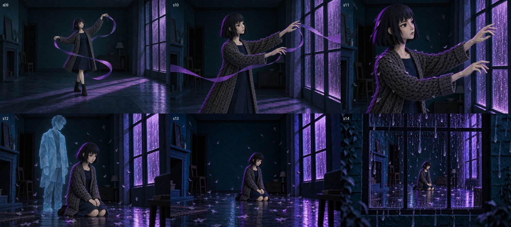
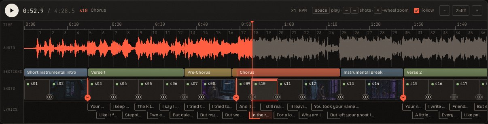
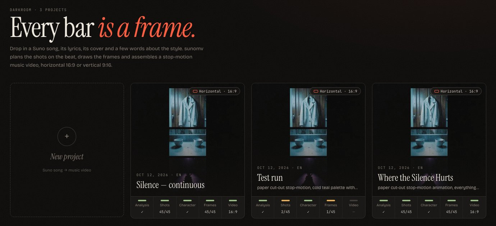
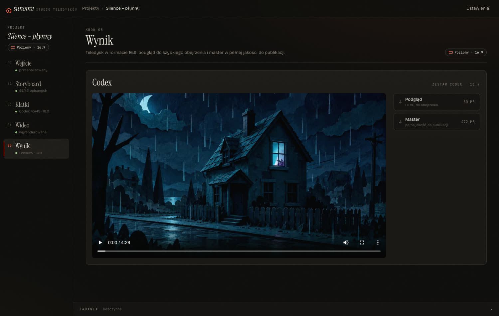

# Tracktake — stop-motion music videos from a Suno song

**Tracktake** turns a song made in [Suno](https://suno.com), its lyrics and its cover art into a frame-by-frame,
paper cut-out style music video that moves to the beat. You type the style, pick horizontal (16:9) or vertical
(9:16), and the tool does the rest. It analyses the music, writes a storyboard, draws a keyframe for every shot,
animates the keyframes and assembles the video with karaoke captions.

**Website:** https://jash90.github.io/suno-audio-wideo/

<p align="center">
  
</p>

## What it does

| Step | What happens | Runs on |
|---|---|---|
| **1. Analysis** | Stems ([Demucs](https://github.com/facebookresearch/demucs)), beats and downbeats ([beat_this](https://github.com/CPJKU/beat_this)), word-level lyric timing ([stable-ts](https://github.com/jianfch/stable-ts) + Whisper large-v3), song sections from the Suno `[Verse]`/`[Chorus]` tags | Mac (MLX/MPS) or a Vast GPU |
| **2. Storyboard** | Two bars per shot, cut on downbeats. A *director* (Claude Code CLI, structured JSON) writes each shot's scene and motion from the lyrics, the cover and your style | local |
| **3. Keyframes** | One complete picture per shot, background and character together, made by the Codex CLI image tool from a character sheet and the cover. ComfyUI Z-Image Turbo is an alternative set | local (Codex) / Vast (ComfyUI) |
| **4. Clips** | [Wan 2.2 14B](https://github.com/Wan-Video/Wan2.2) image-to-video in ComfyUI with 4-step lightx2v LoRAs; continuous shots are animated **first frame → last frame** | rented Vast.ai GPUs |
| **5. Render** | Stop-motion stepping (on twos, a forced new drawing on every beat), downbeat camera pulse, karaoke captions, H.264 master + small HEVC preview | the Vast GPU (NVENC) or the Mac (VideoToolbox) |

### Fewer cuts: continuous takes

A video made of 45 unrelated pictures feels like a slideshow. Tracktake cuts hard only where the song enters a verse,
chorus, bridge, breakdown or outro, which gave **9 cuts instead of 45** in the test song. Every other shot *continues* the
previous one:

- its keyframe is drawn **from the previous keyframe** (same place, light, palette and character, with the camera and
  the action moved on);
- the previous clip is animated with Wan's first-last-frame conditioning, so it **ends exactly on that keyframe**;
- the camera push-in spans the whole continuous run instead of snapping back at every seam.

The last frame of one shot and the first frame of the next differ by about 5/255 per pixel on average, which is
roughly the size of compression noise. Cuts are editable per shot in the storyboard (*Cut* / *Continuous*).

## Web UI

`tracktake serve` starts a local studio (FastAPI and a React single-page app) at `http://127.0.0.1:8770`. The interface is in Polish for now.



| Projects | Result |
|---|---|
|  |  |

- **Projects:** each project is horizontal 16:9 *or* vertical 9:16, with progress per stage.
- **Inputs:** song, lyrics, cover and style; the format can be changed later.
- **Storyboard:** waveform, beat grid, sections, shots and lyric lines on one zoomable timeline. Each shot has an
  editor for its scene, motion and *cut / continuous* setting. The director rewrites all shots or a selection.
- **Keyframes:** the character sheet, then one keyframe per shot in the project format. Each shot can be
  regenerated, with a warning when later continuous shots were drawn from it.
- **Video:** a cost and time estimate for 1/2/4 cards built from live Vast offers. Rendering needs an explicit
  confirmation, then shows live progress.
- **Result:** a player plus downloads of the preview and the master.

Long jobs (analysis, director, keyframes, renders) run in the background with live logs and can be cancelled.
Cancelling a render frees the rented GPUs.

## Requirements

- macOS on Apple Silicon (tested on an M1 Pro, 32 GB) or Linux. Local analysis uses MLX/MPS on a Mac.
- [uv](https://docs.astral.sh/uv/), Python 3.12, `ffmpeg`, Node.js 20+.
- [Claude Code](https://claude.com/claude-code) CLI (`claude`) for the director. The Codex CLI is the fallback.
- [Codex CLI](https://github.com/openai/codex) (`codex`, signed in with ChatGPT) for keyframes.
- A [Vast.ai](https://vast.ai) account and an SSH key for clips and renders. Wan 2.2 14B needs a 24 GB+ CUDA GPU.

## Quick start

```bash
# engine + web API
cd engine
uv sync --extra analysis --extra server --extra vast

# web UI (served by the API from apps/web/dist)
cd ../apps/web
npm install
npm run build

# start the studio
cd ../../engine
uv run tracktake serve            # → http://127.0.0.1:8770
```

Add your Vast.ai API key in the UI (*Settings*) or with `uv run vastai set api-key <key>`.

For frontend development, run `npm run dev` in `apps/web` (port 5173, proxies `/api` and `/files` to :8770).

## Command line

Everything the UI does is also available from the CLI:

```bash
# analysis → analysis.json (beats, downbeats, sections, word timings)
uv run tracktake analyze song.mp3 --lyrics lyrics.txt --out data/work/my-song

# what a render would cost right now, and the cheapest matching offers
uv run tracktake vast offers --gpu RTX_4090

# a whole video on Vast: rent, provision, clips, render, download, free the cards
uv run tracktake remote run --full data/projects/<id>/full --set codex \
  --song data/projects/<id>/input/song.mp3 --analysis data/projects/<id>/analysis.json \
  --workers 1 --orient landscape            # prints the estimate; add --yes to rent

# run the analysis on a Vast GPU instead of the Mac
uv run tracktake remote analyze --song song.mp3 --lyrics lyrics.txt --out data/work/my-song --yes

# manage instances
uv run tracktake vast status
uv run tracktake vast down --all
```

## Vast.ai remote mode

A render never streams frames over SSH tunnels. Workers run their jobs detached on the card and only the finished
MP4 is downloaded:

1. **Rent.** Offers are ranked by hourly price **plus the cost of downloading ~44 GB of models** on that host, since
   some hosts charge $40/TB. Each new host first downloads 1 GB from Hugging Face. A host slower than 40 MB/s, or one
   that never boots or opens SSH, is destroyed and replaced from a pool of spare offers.
2. **Provision.** ComfyUI pinned to commit `0df64eb` (the same commit the graphs are tested against), Wan 2.2 fp8
   models fetched in parallel with resumable retries, plus ffmpeg, fonts and Python dependencies.
3. **Clips.** Shots are spread across cards with the longest shots first. Finished clips are cached, so an
   interrupted job resumes.
4. **Gather.** Helper cards copy their clips to the leader card directly and are released right away.
5. **Render.** On the leader with NVENC; the master and the preview are downloaded and every card is destroyed,
   also on failure or cancel.

Measured on the 4:29 test song (45 shots, one format, one RTX 4090): **about 41 minutes of clips and 9 minutes of
render, about $0.67 in total**. Keyframes are made locally by Codex for no extra cost (about 50–60 s per image, with
continuous chains in parallel).

## Configuration

`config/tracktake.toml` holds the backend choice (local or Vast ComfyUI), the video engine (`mlx` = LTX-2.3 on the
Mac, `wan` = Wan 2.2 on CUDA) and the Vast offer filters (GPU, max $/h, reliability, network, disk, image,
ComfyUI commit, model sets). Environment variables `TRACKTAKE_*` override single values.

## Repository layout

```
engine/            Python package `tracktake` (uv)
  src/tracktake/
    analysis/      stems, beats, sections, lyric alignment
    comfy/         ComfyUI client and API graphs (Z-Image, Qwen edit, Wan I2V / first-last frame)
    render/        compositor, stop-motion stepping, captions, encoders
    storyboard.py  shot planning, cuts, the director prompt
    keyframes.py   Codex keyframes and character sheet (continuity chains)
    vast.py        offers, renting, download-speed probe, provisioning
    remote.py      remote jobs: plan, detached start, gather, render, fetch
    server.py      FastAPI for the web UI;  jobs.py  background jobs
  scripts/         full-video steps (keys, clips, render) that also run on the workers
  tests/           pytest (graphs are checked against the pinned ComfyUI node schemas)
apps/web/          Vite + React 19 + TanStack Query + Tailwind 4 studio UI
comfy/provisioning/  Vast worker setup (ComfyUI, models, runtime)
config/            tracktake.toml
docs/              plan, benchmarks and the cost report (Polish)
site/              the GitHub Pages site
```

## Development

```bash
cd engine && uv run pytest && uv run ruff check src tests scripts
cd apps/web && npm run typecheck
```

Project data (songs, keyframes, clips, videos) lives in `data/`, which is git-ignored.

## Notes

- Only use songs, lyrics and covers you have the rights to. Suno's terms decide what you may do with its
  generations.
- Renting GPUs costs money. The CLI prints an estimate and rents only with `--yes`; the UI asks for confirmation.
- The Wan 2.2 speeds of cards other than the RTX 4090 are estimates until they are measured.
